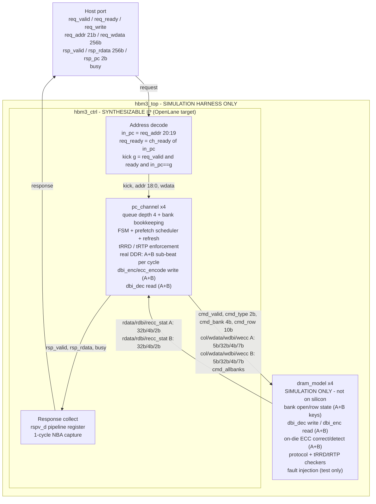
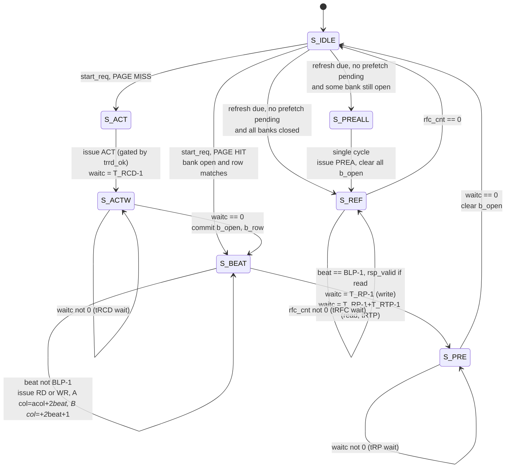

# OpenHBM3 — Architecture, Schematic & Pinout

Block-level schematic, module port maps (pinout), FSM, and address decoding
for the OpenHBM3 controller. Every table here is transcribed directly from
the RTL in [`rtl/`](../rtl) — parameter values are the defaults in
[`rtl/hbm3_defs.svh`](../rtl/hbm3_defs.svh).

> **Which module is the actual IP.** `hbm3_ctrl` is the synthesizable
> controller — everything that would exist on real silicon. `hbm3_top` is a
> thin **simulation harness** that wraps `hbm3_ctrl` together with
> `NUM_PC` behavioral `dram_model` instances so the testbenches can
> instantiate one module and do end-to-end read/write checks. Real HBM3 DRAM
> lives on separate stacked dies reached through a PHY, so it is not part of
> the controller. Synthesis and the OpenLane flow target `hbm3_ctrl`.

## Parameters

| Parameter | Value | Meaning |
|---|---|---|
| `DW` | 32 | Data width per pseudo-channel (DQ) |
| `BL` | 8 | Burst length in beats → 32 B packet |
| `BLP` | 4 (`BL/2`) | **Real DDR**: `S_BEAT` cycles — 2 sub-beats (A+B) move per cycle |
| `BURST_B` | 32 | Bytes per burst (`BL*DW/8`) |
| `NBANKS` | 16 | Banks per pseudo-channel |
| `NBANK_AW` | 4 | Bank address bits (`$clog2(16)`) |
| `ROWBITS` | 10 | Row address bits |
| `COLBITS` | 5 | Column address bits → 32 × 32 B = 1 KB page |
| `NUM_PC` | 4 | Pseudo-channels (simulation; real HBM3 stack: 32) |
| `PCIW` | 2 | Pseudo-channel select bits (`$clog2(NUM_PC)`) |
| `AW` | 21 | Host address width (`PCIW+ROWBITS+NBANK_AW+COLBITS`) |
| `CAW` | 19 | Per-channel address width (`AW-PCIW`) |
| `T_RCD` | 4 | ACT → RD/WR |
| `T_RP` | 4 | PRE → ACT |
| `T_RRD` | 2 | Minimum ACT → ACT spacing (enforced via `trrd_ok`) |
| `T_RTP` | 2 | Minimum last RD → PRE spacing (reads only) |
| `T_REFI` | 200 | Refresh interval (shortened for test visibility; override with `make bandwidth REFI=…`) |
| `T_RFC` | 8 | Refresh duration |

Addressable space: 4 PC × 16 banks × 1024 rows × 32 cols × 32 B = **64 MB**.
(The behavioral `dram_model` truncates the stored row field to 6 bits, so
simulated storage is 4 MB — see [Known limitations](../README.md#known-limitations).)

## Block schematic



## Pinout — `hbm3_ctrl` (the synthesizable IP)

Widths shown are the elaborated values for the default parameters. This is
the module OpenLane hardens; `hbm3_top` has the same host-side ports and
additionally instantiates the behavioral DRAM for simulation.

### Clock & reset

| Signal | Dir | Width | Description |
|---|---|---|---|
| `clk` | in | 1 | Command-clock (CK) domain. Everything in this repo runs here. |
| `rst_n` | in | 1 | Active-low asynchronous reset. |

### Host request/response interface

| Signal | Dir | Width | Description |
|---|---|---|---|
| `req_valid` | in | 1 | Request asserted by host. |
| `req_ready` | out | 1 | Target pseudo-channel can accept. `= ch_ready[in_pc]` — **address-dependent**, see note below. |
| `req_write` | in | 1 | 1 = write, 0 = read. |
| `req_addr` | in | 21 | `{pc[1:0], row[9:0], bank[3:0], col[4:0]}` |
| `req_wdata` | in | 256 | Full 32 B burst payload (8 beats × 32 bit). |
| `rsp_valid` | out | 1 | Read response valid (1 cycle pulse). |
| `rsp_rdata` | out | 256 | Read burst payload, DBI already decoded. |
| `rsp_pc` | out | 2 | Which pseudo-channel produced the response. |
| `busy` | out | 1 | Any channel has unretired work: FSM not idle, queue non-empty, or a speculative `ACT` not yet committed. Writes have no response, so this is the only observable completion signal for them. |

> `req_ready` depends on `req_addr` (it selects the channel before the
> handshake completes). That is **not** AXI-compliant `VALID/READY`
> independence — noted in [Known limitations](../README.md#known-limitations).
> Responses are returned in order and carry no request tag; `rsp_pc` is
> informational only.

### DRAM / PHY command interface

In `hbm3_ctrl` these are **real ports** — the controller drives commands out
to the PHY and receives read data back. (In the `hbm3_top` simulation
harness the same names appear, but there they are observability taps, since
the DRAM model is wired up internally.) One slice per pseudo-channel,
flattened into a single vector: channel `g` occupies bits `[W*g +: W]`.

| Signal | Dir | Width | Per-channel slice |
|---|---|---|---|
| `cmd_valid` | out | 4 | `[g]` — command issued this cycle |
| `cmd_type` | out | 8 | `[2g +: 2]` — `00`=ACT `01`=RD `10`=WR `11`=PRE |
| `cmd_bank` | out | 16 | `[4g +: 4]` |
| `cmd_row` | out | 40 | `[10g +: 10]` |
| `cmd_col` | out | 20 | `[5g +: 5]` |
| `cmd_wdata` | out | 128 | `[32g +: 32]` — DBI-**encoded** (wire-level), sub-beat A |
| `cmd_wdbi` | out | 16 | `[4g +: 4]` — per-byte write inversion flags, A |
| `cmd_wecc` | out | 28 | `[7g +: 7]` — SECDED check bits (raw data, pre-DBI), A |
| `cmd_allbanks` | out | 4 | `[g]` — with `PRE`, means `PREA` (precharge-all) |
| `cmd_rdata` | **in** | 128 | `[32g +: 32]` — DBI-encoded read data from DRAM, A |
| `cmd_rdbi` | **in** | 16 | `[4g +: 4]` — per-byte read inversion flags, A |
| `cmd_recc_stat` | **in** | 8 | `[2g +: 2]` — on-die ECC status, A: `00`=clean `01`=corrected `10`=uncorrectable |
| `cmd_col_b` | out | 20 | `[5g +: 5]` — **real DDR sub-beat B**, same cycle as A, adjacent column |
| `cmd_wdata_b`/`cmd_wdbi_b`/`cmd_wecc_b` | out | 128/16/28 | Same meaning as the A columns above, sub-beat B |
| `cmd_rdata_b`/`cmd_rdbi_b`/`cmd_recc_stat_b` | **in** | 128/16/8 | Same meaning as the A columns above, sub-beat B |
| `ecc_corrected_sticky` | out | 4 | `[g]` — latched high on any single-bit ECC correction (A or B), until reset |
| `ecc_uncorrectable_sticky` | out | 4 | `[g]` — latched high on any double-bit ECC detection (A or B), until reset |

**Signal count:** ~845 input bits, ~1030 output bits — roughly double the
pre-DDR/ECC port count, almost entirely from duplicating the A-path signals
for sub-beat B plus the 7-bit ECC fields.

## Pinout — `pc_channel` (one pseudo-channel controller)

| Signal | Dir | Width | Description |
|---|---|---|---|
| `clk`, `rst_n` | in | 1, 1 | Clock, async active-low reset |
| `req_valid` | in | 1 | Enqueue strobe (`kick` from top) |
| `req_ready` | out | 1 | `!q_full && (st == S_IDLE)` |
| `req_write` | in | 1 | Write/read |
| `req_addr` | in | 19 | `{row[9:0], bank[3:0], col[4:0]}` (pc field stripped) |
| `req_wdata` | in | 256 | Burst payload |
| `rsp_valid` | out | 1 | Read data ready (NBA — capture next cycle) |
| `rsp_rdata` | out | 256 | DBI-decoded read burst |
| `cmd_valid` | out | 1 | Command bus strobe |
| `cmd_type` | out | 2 | ACT / RD / WR / PRE |
| `cmd_bank` | out | 4 | Target bank |
| `cmd_row` | out | 10 | Row (valid on ACT) |
| `cmd_col` | out | 5 | Column, sub-beat A, `= acol + 2*beat` |
| `cmd_wdata` | out | 32 | DBI-encoded write beat, A |
| `cmd_wdbi` | out | 4 | Write inversion flags, A |
| `cmd_wecc` | out | 7 | SECDED check bits (raw data), A |
| `cmd_allbanks` | out | 1 | With `PRE`: `PREA`, close all banks (models the A10 bit) |
| `cmd_rdata` | in | 32 | DBI-encoded read beat from DRAM, A |
| `cmd_rdbi` | in | 4 | Read inversion flags, A |
| `cmd_recc_stat` | in | 2 | On-die ECC status, A |
| `cmd_col_b` | out | 5 | **Real DDR**: sub-beat B, same cycle as A, `= acol + 2*beat + 1` |
| `cmd_wdata_b`/`cmd_wdbi_b`/`cmd_wecc_b` | out | 32/4/7 | Sub-beat B, own DBI/ECC encoder instances |
| `cmd_rdata_b`/`cmd_rdbi_b`/`cmd_recc_stat_b` | in | 32/4/2 | Sub-beat B |
| `ecc_corrected_sticky` | out | 1 | Latched on any single-bit correction (A or B), held until reset |
| `ecc_uncorrectable_sticky` | out | 1 | Latched on any double-bit detection (A or B), held until reset |
| `refreshing` | out | 1 | `st == S_REF` (status/observability) |
| `busy` | out | 1 | `st != S_IDLE`, queue non-empty, or prefetch commit pending |

## Pinout — `dram_model` (behavioral DRAM, simulation only)

| Signal | Dir | Width | Description |
|---|---|---|---|
| `clk`, `rst_n` | in | 1, 1 | Clock, reset |
| `cmd_valid` | in | 1 | Command strobe |
| `cmd_type` | in | 2 | ACT / RD / WR / PRE |
| `cmd_bank` | in | 4 | Bank select |
| `cmd_row` | in | 10 | Row (latched on ACT into `open_row[]`) |
| `cmd_col` | in | 5 | Column |
| `cmd_wdata` | in | 32 | Wire-level (encoded) write data, A |
| `cmd_wdbi` | in | 4 | Write inversion flags — decoded before storage, A |
| `cmd_wecc` | in | 7 | SECDED check bits, stored alongside the data word, A |
| `cmd_allbanks` | in | 1 | With `PRE`: clear every bank's open bit (`PREA`) |
| `cmd_rdata` | out | 32 | Wire-level (encoded) read data — **already ECC-corrected**, A |
| `cmd_rdbi` | out | 4 | Read inversion flags — encoded from the corrected value, A |
| `cmd_recc_stat` | out | 2 | On-die ECC status for this access, A |
| `cmd_col_b`/`cmd_wdata_b`/`cmd_wdbi_b`/`cmd_wecc_b` | in | 5/32/4/7 | **Real DDR**: sub-beat B, same cycle, adjacent column |
| `cmd_rdata_b`/`cmd_rdbi_b`/`cmd_recc_stat_b` | out | 32/4/2 | Sub-beat B |
| `fault_valid` | in | 1 | **Simulation only** — enable the bit-flip injector this cycle |
| `fault_key` | in | 15 | **Simulation only** — storage key to corrupt (same encoding as the internal `skey`) |
| `fault_flip` | in | 39 | **Simulation only** — XOR mask over `{ecc[6:0], data[31:0]}`; 1 bits are flipped |

On-die ECC correction happens *inside* this module (`ecc_decode`, per
sub-beat) before data ever reaches `cmd_rdata`/`cmd_rdata_b` — matching real
HBM3 semantics where ECC is invisible to the controller except through a
status signal. `fault_valid`/`fault_key`/`fault_flip` exist only because
this module is never synthesized (see the module header note); they are how
[`tb/tb_ecc_fault.sv`](../tb/tb_ecc_fault.sv) proves the whole chain works
end-to-end rather than trusting the unit test alone.

Protocol/timing checkers, reported as `[DRAM-HATA]` (A and B checked
independently where noted):

| Checker | Fires when | Guards against |
|---|---|---|
| `err_closed` | RD/WR to a bank with `open[b]==0` | Column access without ACT |
| `err_react` | ACT to a bank with `open[b]==1` | Second ACT without an intervening PRE (see [HATA 9](HATALAR.md)) |
| `tRRD` check | Two ACTs closer than `T_RRD` cycles | Row-activate current spikes (see [HATA 13](HATALAR.md)) |
| `tRTP` check | PRE closer than `T_RTP` after that bank's last RD | Precharging before read data has left the core |
| Aliasing tag (A, B) | Stored row tag ≠ requested row at the same key | Silent `RSTOR`-truncation collisions (see [HATA 4](HATALAR.md), [HATA 14](HATALAR.md)) |

## Pinout — `dbi_enc` / `dbi_dec`

| Module | Signal | Dir | Width | Description |
|---|---|---|---|---|
| `dbi_enc` | `din` | in | `BYTES*8` | Raw data |
| | `dout` | out | `BYTES*8` | Wire data (bytes with >4 zeros inverted) |
| | `dbi` | out | `BYTES` | 1 = that byte was inverted |
| `dbi_dec` | `din` | in | `BYTES*8` | Wire data |
| | `dbi` | in | `BYTES` | Inversion flags |
| | `dout` | out | `BYTES*8` | Raw data |

`BYTES=4` everywhere in this design (32-bit DQ per pseudo-channel).
Inversion rule is strictly `zeros > 4` — a byte with exactly 4 zeros is
**not** inverted.

## Pinout — `ecc_encode` / `ecc_decode`

| Module | Signal | Dir | Width | Description |
|---|---|---|---|---|
| `ecc_encode` | `din` | in | 32 | Raw data |
| | `ecc` | out | 7 | `[5:0]` Hamming check bits + `[6]` overall parity |
| `ecc_decode` | `din` | in | 32 | Possibly-corrupted data |
| | `ecc` | in | 7 | Possibly-corrupted check bits |
| | `dout` | out | 32 | Corrected data (only meaningful if not `err_uncorrectable`) |
| | `err_corrected` | out | 1 | A single-bit error was found and corrected |
| | `err_uncorrectable` | out | 1 | A double-bit error was detected (not correctable) |

Hamming(39,32) SECDED: 32 data bits placed at the non-power-of-2 positions
of a 39-bit codeword, 6 Hamming check bits at positions 1/2/4/8/16/32, plus
1 overall-parity bit covering all 38 other bits. Decode logic:
`syndrome == 0` means no error in the 38 Hamming-covered bits; a non-zero
syndrome combined with odd overall parity means exactly one bit is wrong
(correctable — the syndrome value *is* the bit position to flip); a
non-zero syndrome combined with even overall parity means two bits are
wrong (detected, not correctable). This is a real, working implementation
of SECDED — not JEDEC's literal "2 ECC pins per PC" scheme, which is an
internal DRAM-array mechanism not meaningfully modelable at this level; see
[HATA 15](HATALAR.md) for why, and for a real polarity bug this design had
until a fault-injection test caught it.

## Address map

```
req_addr[20:0]
 ┌────────┬──────────────────────┬───────────┬──────────────┐
 │ pc[1:0]│      row[9:0]        │ bank[3:0] │   col[4:0]   │
 └────────┴──────────────────────┴───────────┴──────────────┘
  20    19 18                   9 8         5 4            0
     4 ch        1024 rows         16 banks    32 × 32 B = 1 KB page
```

Column is the fastest-varying (LSB) field so that sequential bursts walk
within an open page; bank sits above it so that a stride of one page
round-robins across banks (which is what lets the prefetch scheduler find a
*different* bank to activate early).

`hbm3_top` splits this as: `in_pc = req_addr[20:19]`, and passes
`req_addr[18:0]` down to the selected `pc_channel`.

## Pseudo-channel FSM



`S_PREALL` exists so that refresh issues a **real** `PREA` (precharge-all)
command before entering `S_REF`, instead of silently clearing the
controller's `b_open` bookkeeping and drifting out of sync with the DRAM.
`PREA` is a single command that closes every bank at once — real DDR/HBM
parts encode it as a `PRE` with the A10 address bit set, which is why it
appears here as `cmd_type = PRE` plus a `cmd_allbanks` flag rather than a
fifth opcode. Modeling it correctly also keeps refresh cheap: one cycle
instead of a 16-bank scan.
`pf_commit_pending` blocks the refresh entry (and the queue pop) while a
speculative prefetch `ACT` is in flight but not yet committed — both are
part of the [HATA 9](HATALAR.md) fix.

## Command timing — page-miss access (real DDR)

Cycle budget for one full access with no prefetch help, **with real DDR**
(two sub-beats per `S_BEAT` cycle, `BLP = BL/2 = 4`):

| Cycles | State | Command bus | Note |
|---|---|---|---|
| 1 | `S_ACT` | `ACT` | Sets `waitc = T_RCD-1 = 3`; gated by `trrd_ok` |
| 4 | `S_ACTW` | idle | `tRCD` wait; **prefetch may use this bus** |
| 4 | `S_BEAT` | `RD`/`WR` × 4, A+B each cycle | 8 bytes/cycle now move (was 4) — the only data-moving cycles |
| +1 | `S_PRE` | idle | **reads only**: `tRTP` wait before `PRE` is legal |
| 1 | `S_PRE` | `PRE` | Issued when `waitc == T_RP-1` |
| 3 | `S_PRE` | idle | `tRP` wait; **prefetch may use this bus** |
| **13** (14 rd) | | | 4 of 13 cycles move data (at 2× rate) → **30.8 %** serial ceiling (write); 28.6 % (read) |

Pre-DDR this table read `1+4+8+1+3=17` cycles, 8 of which moved data at the
single-beat rate, for a 47.1 % floor. DDR halves the burst-phase cycle
count (`BL`→`BLP`) *and* doubles the per-cycle rate during it — the
absolute data-moving capacity of that phase is unchanged (still 32 bytes in
the same wall-clock time at a fixed frequency), but it now finishes in half
the cycles, so the **ACT/PRE overhead cycles are a bigger fraction of the
total** — which is exactly why the *percentage* floor drops (47.1 %→30.8 %)
even though *absolute* throughput goes up. Both are correct; see
[HATA 17](HATALAR.md) for the exact mistake this would have been to miss.

Measured against that floor (`make bandwidth-norefresh` / `make bandwidth`):

| Configuration | Cycles (64 accesses) | % of DDR peak | Absolute |
|---|---|---|---|
| Prefetch on, refresh off | 769 W / 769 R | **33.3 %** | 0.266 GB/s |
| Prefetch on, refresh on (`T_REFI=200`) | 811 W / 825 R | 31.6 % / 31.0 % | 0.253 / 0.248 GB/s |

Both rows sit a real margin above the 30.8 %/28.6 % analytic floor — the
same `tRCD`-hiding prefetch mechanism as before, just measured against
DDR's tighter cycle count. The default `T_REFI=200` is ~31× more aggressive
than real HBM3 (`tREFI` ≈ 3.9 µs ≈ 6240 cycles at 1.6 GHz), chosen so
refresh stays visible in short simulations; at a realistic interval its
cost falls below 1 %. The prefetch scheduler hides `tRCD` and never `tRP`
— see [Known limitations](../README.md#known-limitations).

## What still separates this from a real part

The DRAM is **not** inside the synthesized design: `hbm3_ctrl` drives
`cmd_*` out as real ports and takes `cmd_rdata`/`cmd_rdbi` back in, exactly
as a controller die would talk to a PHY. `hbm3_top` — the simulation
harness — is what wires the behavioral `dram_model` onto those ports.
`hbm3_ctrl` is what OpenLane hardens.

What is still missing is the PHY layer itself. A production part would add,
per pseudo-channel:

| Group | Signals | Notes |
|---|---|---|
| Command/address | `R[.]`, `C[.]` row & column command buses | Shared within a channel — already modeled here |
| Data | `DQ[31:0]` ×2 (A+B) | DBI already implemented and wired, **real DDR** doubles data/cycle |
| Data strobe | `WDQS`/`RDQS` or a true 2× `WCK` domain | **Not implemented** — this design's DDR uses two sub-beats in the *single* core clock domain, not a separate faster WCK; `wck_div.sv` remains a cosmetic CK÷2 divider |
| ECC | 2 pins per PC (on-die array ECC) | Implemented differently: a real 7-bit SECDED code protecting data at rest, not JEDEC's literal 2-pin on-die scheme — see [HATA 15](HATALAR.md) |
| Control | `CKE`, `CK_t/CK_c` | Only a single `clk` here |

The command protocol, bank state machine, timing enforcement
(`tRCD`/`tRP`/`tRRD`/`tRTP`/`tREFI`/`tRFC`), DBI, ECC, real DDR sub-beat
transfer, refresh with `PREA`, and the prefetch scheduler all carry over
as-is. A true multi-GHz WCK clock domain (needs a PLL/clock-multiplier),
the analog PHY, CDC, and a wide/multi-ported host interface are not
written — see [Known limitations](../README.md#known-limitations).

## File map

| File | Role |
|---|---|
| [`rtl/hbm3_defs.svh`](../rtl/hbm3_defs.svh) | Parameters, timing, command encoding |
| [`rtl/hbm3_ctrl.sv`](../rtl/hbm3_ctrl.sv) | **Synthesizable IP**: address decode, channel fan-out, response collect |
| [`rtl/hbm3_top.sv`](../rtl/hbm3_top.sv) | Simulation harness: `hbm3_ctrl` + behavioral DRAM |
| [`rtl/pc_channel.sv`](../rtl/pc_channel.sv) | Queue, bank bookkeeping, FSM, prefetch, refresh, timing enforcement, real DDR (A/B sub-beats) |
| [`rtl/dram_model.sv`](../rtl/dram_model.sv) | Behavioral DRAM + protocol/timing/aliasing checkers, on-die ECC, fault injection |
| [`rtl/dbi.sv`](../rtl/dbi.sv) | `dbi_enc` / `dbi_dec` |
| [`rtl/ecc.sv`](../rtl/ecc.sv) | `ecc_encode` / `ecc_decode` — Hamming(39,32) SECDED |
| [`rtl/wck_div.sv`](../rtl/wck_div.sv) | CK→WCK divider (observability only) |
| [`tb/tb_hbm3.sv`](../tb/tb_hbm3.sv) | Correctness regression (26 checks) |
| [`tb/tb_bandwidth.sv`](../tb/tb_bandwidth.sv) | Pipelined bandwidth benchmark |
| [`tb/tb_alias.sv`](../tb/tb_alias.sv) | Negative test for the storage-aliasing detector |
| [`tb/tb_ecc.sv`](../tb/tb_ecc.sv) | ECC unit test (100 cases) |
| [`tb/tb_ecc_fault.sv`](../tb/tb_ecc_fault.sv) | ECC end-to-end negative test (real fault injection) |
| [`docs/HATALAR.md`](HATALAR.md) | Every bug found: root cause, fix, lesson |
